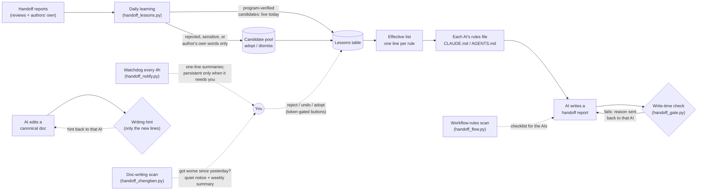

# self-improving-handoffs

**Make multi-AI handoffs get better on their own.** A write-time checker for handoff reports, a shared "lessons book" that learns from the mistakes caught in those reports and goes live the same day, and a writing check that notices when a project's canonical docs start to rot — all without a human approving each rule.

[](https://github.com/Wyk915501/self-improving-handoffs/actions/workflows/tests.yml)


> 📖 **中文完整说明 → [README.zh-CN.md](README.zh-CN.md)**
>
> ⚠️ **This project is Chinese-first.** File-name conventions (`*_交接报告.md` under a `工作传递/` folder, canonical docs under `项目情况/`), all script messages, notifications and the detailed docs are in Chinese. This page is an overview.

---

## The problem

When several AI tools (Claude Code, Codex, ZCode, …) hand work to each other through a shared docs tree:

- **Rules written in docs don't get read** at the moment someone is writing a report.
- **The same format mistakes keep coming back** — broken headers, wrong timestamps, dead links.
- **Every new rule needs a human to approve it**, so the improvement loop never actually turns.
- **The canonical project docs slowly turn into a changelog** — status pages grow past ten thousand characters, "update: …" lines pile up at the bottom, and nobody notices until a big clean-up.

## How it works



1. **Write-time check** (no LLM). Every time an AI writes a handoff report, a hook runs `handoff_gate.py` and checks file name, front-matter validity, status words, required keys, real timestamps, temp-dir references, links, and edits to already-frozen reports; index READMEs get their own link check. The reason goes back to *that* AI so it fixes its own report. A scan every 4 hours covers writers that have no hooks.
2. **Daily learning** (one model call per day, split into ≤3 batches when there is a backlog). Handoff reports are fed to a model that may only return JSON candidates — it has no file access. **The program then verifies each candidate**: every quote must appear verbatim in the source, evidence must come from ≥2 independent original events, the category must be whitelisted, and it must not duplicate existing or rejected rules. **Survivors go live the same day.** Reports written by the working AI itself are read too, but there only **attributed quotes** count as evidence (a reviewer's or the owner's name followed by a quotation, or "X pointed out: …"); a candidate backed only by the author's own words is held until the human clicks *Adopt*. Candidates that touch sensitive topics (permissions, deployment, deletion, secrets) or carry commands, URLs, local paths or invisible characters are held the same way.
3. **Distribution.** Only the currently effective rules (one line each, capped at 40) are written to a short file that each AI's rules file imports at the start of a session.
4. **Watchdog** (no LLM, every 4 hours, Windows). Native toast notifications grouped by kind: a quiet one-line summary of new rules; a persistent "needs you" toast only for real failures, always with the fix in its second line; everything else is a quiet notice that expires after a day. A local decision page lists everything with token-gated buttons (*Reject*, *Undo*, *Restore*, *Adopt*). Rule cards show where the rule came from, how many times the same mistake was recognised again after it went live, and an *I have an opinion* sentence you can paste into any AI window.
5. **Workflow-rules scan** (no LLM, report-only). Checks process rules such as "a report declared a backflow target that never got updated" or "a burst of tiny reports instead of one draft". Findings go to a checklist the AIs read when they start work — they never pop up.
6. **Doc-writing check** (no LLM, new in v9). For canonical project docs under `docs/项目情况/`: when an AI writes one, the hook hints only about the lines it just wrote (never blocks). Every 4 hours a full scan checks nine script-checkable rules — local file paths in backticks instead of links, a page calling itself "the only/latest", "MM-DD update:" lines piled at the end, dates stacked in headings, status-page items without an as-of date or older than 14 days, a status page over 2,000 characters, files over 50 KB, more than 10 change-log lines. "Got worse" means newly written problems compared with the run ~20 hours earlier — counted by rule + quoted sentence across the whole tree, so moving or renaming files is not a regression; already-oversized pages that grew further count too. The human gets one quiet notice saying which page, which rule, and whether that write went through the hook, plus a weekly summary.

## What you actually do

Nothing, most days. When you want to:

- **Reject a rule you don't like** — click the toast, then *Reject* on the decision page; it is removed from the effective list immediately. Misclicked? *Undo* at the top of the page.
- **Adopt a held candidate you do like** — one click.
- **Chase a doc that got worse** — the decision page lists the page, the line, the sentence, whether it has been fixed since, and a sentence to forward to that project's AI window.
- **Act on a "needs you" toast** — its second line says what to do.

## Quick start

Requirements: Python 3.10+ and `pip install pyyaml` (without it the checker fails closed). The daily-learning step additionally needs a model — see below.

```bash
git clone https://github.com/Wyk915501/self-improving-handoffs
cd self-improving-handoffs
pip install pyyaml
python -X utf8 规范/交接写时门/handoffctl.py test        # all seven suites; prints the SHA of every file under test
python -X utf8 规范/交接写时门/handoffctl.py install --dry-run   # see what it would do
```

On **Windows**, `install` (without `--dry-run`) creates a runtime directory `~/.claude/handoff/`, deploys a tested copy of the scripts (pinned by a SHA-256 manifest), writes a minimal config, installs project-level write-time hooks for Claude Code and ZCode, creates two scheduled tasks (daily learning and a 4-hourly watchdog, both via `pythonw`), registers the decision-page URL protocol, installs the operations skill, and runs `doctor`. On **Linux**, it installs the hooks and the skill and prints a suggested cron line for the periodic scan — daily learning and notifications live on a single Windows publisher.

Then follow **[README.zh-CN.md → 十分钟装起来](README.zh-CN.md)**: trim the report template to the keys you actually want, set which report folders the daily learning reads (`SOURCES`, `SELF_SOURCES` in `handoff_common.py`), and write one deliberately broken report to confirm the AI gets the failure reason back.

Day to day: `handoffctl.py status` (one screen), `handoffctl.py doctor` (read-only health check). After editing a script: `test` → `promote` → `doctor` — scheduled tasks, hooks and buttons only ever run the promoted copy.

## Which model, and who pays

Only the daily-learning step calls a model, once a day. The checker, the scanners and the watchdog call **no model at all**.

| `lessons.provider` | What it calls | Whose quota |
|---|---|---|
| `glm` (default) | Zhipu `glm-5.3` **through Claude Code** (`claude -p --bare --model glm-5.3`, pointed at Zhipu's Anthropic-compatible endpoint) | your GLM Coding Plan subscription |
| `claude` | your logged-in Claude Code (default model `sonnet`) | that Claude account |

Why through Claude Code: Zhipu's terms say the GLM Coding Plan may only be used inside the coding tools they support, so the scripts refuse any `/api/coding/` endpoint; calling the API directly (`lessons.glm_via: "api"`) is only allowed against the standard pay-as-you-go endpoint. Both providers go through the same program-side verification.

## Validation, honestly

- **664 regression tests** in seven suites, all calling the production code with state in temporary directories, run on Windows (Python 3.14); CI runs them on Linux and Windows with Python 3.10 and 3.12. The toast XML is round-tripped through Windows' own XML parser in a dry run; that part is skipped (reported as SKIP, not PASS) elsewhere.
- Key fixes are proven by mutation: put the old behaviour back and the matching test must fail. For v9 this was done once, with a script kept outside the repo, for six fixes (network paths, re-registered page types, attributed quotes, unreadable files, oversized pages that keep growing, a fixed problem that comes back) — all caught.
- An independent review of the first v9 draft found seven must-fix issues; all were fixed and each is covered by a test, but the fixed version was not re-reviewed (the "attributed quote" rule was too loose, the "got worse" comparison misfired on renames and could miss new problems during clean-ups, oversized pages could grow unnoticed, a fixed-then-repeated problem was not reported again, a network path could reach the file system, a notification claimed something the program had not checked, and the landing page did not say which page got worse).
- In daily use since September 2026 on one Windows machine (the publisher). The Linux side (checks only) has run on a server and runs in CI on every push.

This is a working, tested prototype with its limits written down — not a finished product.

## Limits

- It is a **post-write hint, not a gate**: it can't stop a write, and it checks format, not whether the content is right.
- A new rule is free text; the program cannot prove it's only about report-writing, and a report can cite real report IDs around an invented story. "Attributed quote" only recognises the obvious patterns — an author who writes their own opinion as "the owner said: …" is not caught. The backstops are verbatim quotes, independent events, hard blocks on sensitive shapes, a one-line summary of every new rule, and one-click removal.
- The doc-writing check covers nine script-checkable rules only; anything that needs judgement (narrative "first we… then we…", duplicated facts across pages) is out of scope.
- Notifications are Windows-only and only visible at the logged-in desktop. If the watchdog stops, the daily run notices within a day; if the machine is off, nothing does.
- Scheduled tasks **must use `pythonw.exe`** (`install` does this): with `python.exe` a console window flashes on every run, and closing it kills the running job.
- Only one machine may publish (run the daily learning); others just read the effective list.
- At the cap (40 rules) new rules pause; merging rules is drafted by an AI and approved by the human.

## Layout

```
规范/交接写时门/     the scripts, their detailed docs (README.md), the operations skill and the seven test suites
                    (gate v2.9, lessons v3.11, notify v1.15, flow v0.4, zhengben v1.1, handoffctl, handoff_common)
工作传递/            sample docs tree: report template, a synthetic lessons table and files the scripts generated from it
部署样例/            hook snippets (Claude Code, ZCode, Linux), rules-file snippets, cron example
```

## License

MIT — see [LICENSE](LICENSE).
